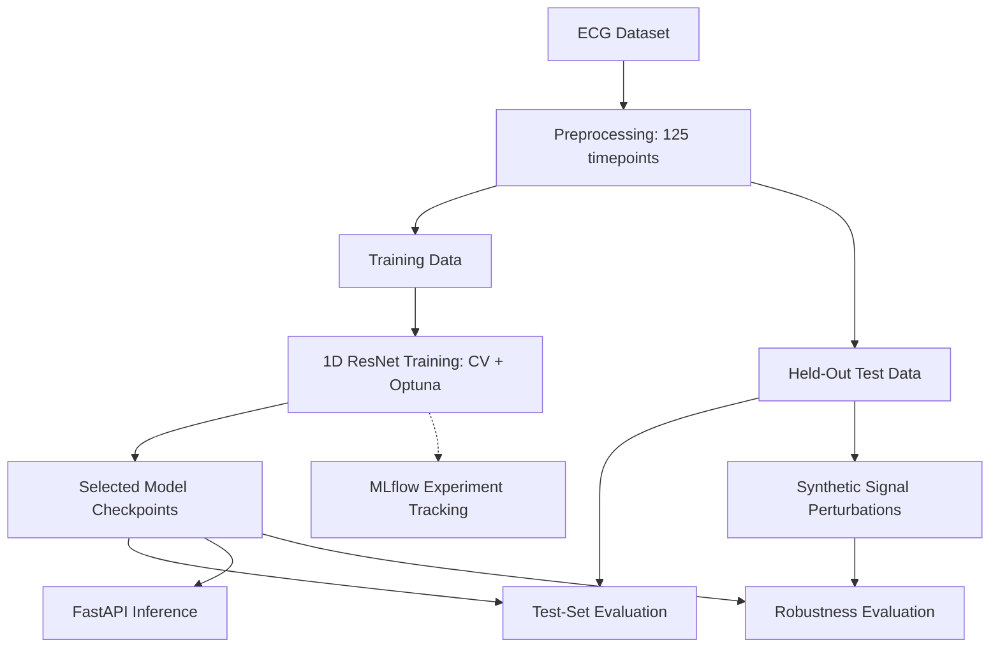
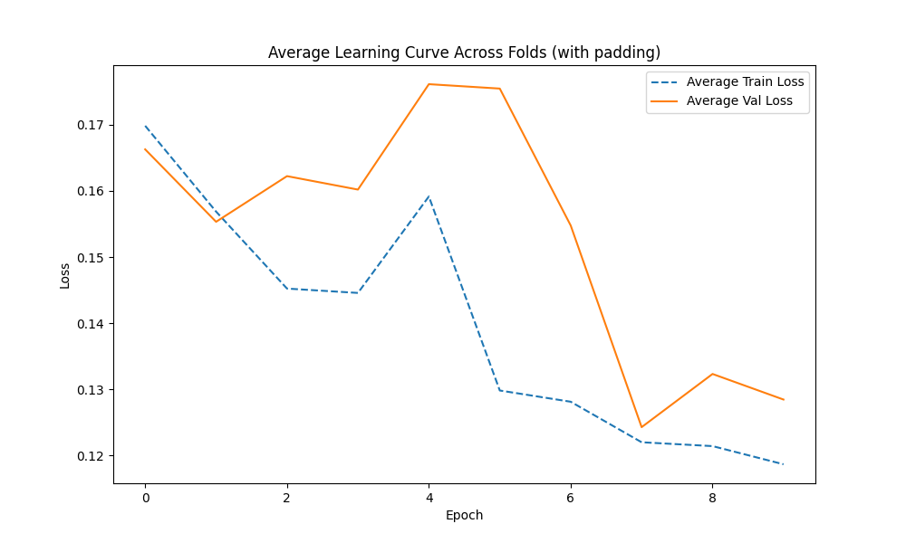

# ECG Heartbeat Classification with PyTorch ResNet

**Deep Learning · Model Optimization · Robustness Evaluation · MLflow · FastAPI**

<a target="_blank" href="https://cookiecutter-data-science.drivendata.org/">
    
</a>

An end-to-end machine learning project exploring multiclass ECG heartbeat classification using a one-dimensional residual neural network (ResNet).

The project demonstrates a workflow spanning ECG preprocessing, model development, hyperparameter optimization, experiment tracking, evaluation under simulated distribution shifts, and API-based inference.

The implementation investigates trade-offs involved in shortening input sequences, handling class imbalance, and explores model robustness under simulated signal perturbations, highlighting practical considerations in preparing ML models for deployment.

## Key Components

| Component | Implementation |
|---|---|
| Data | MIT-BIH heartbeat classification dataset |
| Architecture | 1D ResNet implemented in PyTorch |
| Training | Stratified CV, AdamW, early stopping, class-weighted loss |
| Optimization | Optuna hyperparameter search |
| Experiment tracking | MLflow |
| Evaluation | Classification metrics and simulated data shifts |
| Inference | FastAPI prediction endpoint |
| Organization | Modular Python code and Jupyter walkthroughs |

## Pipeline Overview



## Modeling Approach

### Architecture

The model uses a one-dimensional residual convolutional network adapted from Kachuee et al. (2018).

The input was shortened from 187 to 125 timepoints, with adjustments to pooling operations to accommodate the shorter sequences.

### Model Training

The implementation explores learning rate, batch size, and weight decay through Optuna, using stratified cross-validation and validation-loss-based model selection.

It includes learning-rate scheduling, early stopping, and class-weighted cross-entropy to address class imbalance.

## Results & Model Evaluation

The original experiments evaluated a five-class ECG heartbeat classifier on the MIT-BIH heartbeat dataset using a held-out test partition.

### Recorded Test-Set Performance

| Metric | Result |
|---|---:|
| Test samples | 21,892 |
| Accuracy | 0.96 |
| Macro precision | 0.77 |
| Macro recall | 0.94 |
| Macro F1-score | 0.83 |
| Weighted F1-score | 0.96 |

### Performance by Class

| Class | Precision | Recall | F1-score | Support |
|---|---:|---:|---:|---:|
| 0 | 0.99 | 0.96 | 0.98 | 18,118 |
| 1 | 0.53 | 0.87 | 0.66 | 556 |
| 2 | 0.93 | 0.95 | 0.94 | 1,448 |
| 3 | 0.42 | 0.93 | 0.58 | 162 |
| 4 | 0.97 | 0.99 | 0.98 | 1,608 |

[Full classification report figure](reports/figures/classification_report.png)

**Interpretation:** Overall accuracy is high, but class imbalance makes accuracy insufficient as a standalone metric.

The model's recorded results show relatively high recall across classes, including minority classes 1 and 3. However, precision is substantially lower for those classes, indicating a greater proportion of false-positive predictions.

This illustrates the importance of inspecting class-specific performance rather than relying exclusively on aggregate accuracy.

### Training Dynamics

Training and validation losses were tracked across folds to examine
optimization behavior, learning-rate adjustments, and early stopping.

The following figure shows the learning curves from the original
experiments. These curves are historical artifacts and will be
regenerated after correcting the cross-validation implementation.



## Robustness Under Simulated Data Shifts

A separate experiment investigated how classification performance changes when ECG signals are subjected to progressively stronger perturbations.

The simulated shifts included:

- **Gaussian noise:** Random measurement noise added to the signal.
- **Baseline wander:** Low-frequency drift in the signal baseline.
- **Amplitude changes:** Modifications to signal magnitude.
- **Temporal stretching/compression:** Changes to the signal's temporal structure.

### Observations

In the original experiments, stronger perturbations were associated with deteriorating classification performance.

An important pattern was a substantial decline in minority-class recall, while precision declined less sharply.

This suggests that under these simulated shifts, the classifier increasingly assigned minority-class examples to the majority class.

Such behavior is particularly relevant to biomedical classification, where aggregate accuracy may conceal deteriorating performance on clinically important minority classes.

### Limitations of the Robustness Experiment

These perturbations are synthetic and do not necessarily reproduce real-world distribution shifts.


## Getting Started

### 1. Clone the Repository

```bash
git clone https://github.com/anthonyromyn/ECG_ResNet_Pipeline.git
cd ECG_ResNet_Pipeline
```

### 2. Set Up the Python Environment

The project was developed using Python and PyTorch.

Create and activate a virtual environment:

```bash
python -m venv .venv
source .venv/bin/activate
```

On Windows (PowerShell), activate with:

```powershell
.venv\Scripts\Activate.ps1
```

Install the dependencies:

```bash
python -m pip install -r requirements.txt
```

The original Makefile also supports environment creation through `make create_environment`, which relies on `virtualenvwrapper`.

### 3. Download and Preprocess the Data

Download the ECG dataset:

```bash
make data
```

This uses KaggleHub to obtain the heartbeat classification dataset and place the files in `data/raw/`.

Preprocess the dataset:

```bash
make preprocess
```

This generates cropped training and test datasets containing 125 ECG timepoints per heartbeat, plus the class label.

The processed datasets are saved in `data/processed/`.

The `data/` directory is excluded from Git and is generated locally.

### 4. Explore the Notebooks

The notebooks provide a guided walkthrough of the workflow:

| Notebook | Description |
|---|---|
| [Chapter 1 — Data Processing](notebooks/chapter_1_data_processing.ipynb) | ECG preprocessing and signal augmentation |
| [Chapter 2 — Model Training](notebooks/chapter_2_model_training.ipynb) | ResNet training, optimization, and evaluation |
| [Chapter 3 — Performance Under Data Shifts](notebooks/chapter_3_performance_under_data_shifts.ipynb) | Robustness under simulated signal perturbations |
| [Chapter 4 — Deployment Strategies](notebooks/chapter_4_deployment_strategies.ipynb) | Model inference, API testing, and deployment considerations |

The notebooks are intended to be explored sequentially.

## Experiment Tracking & Workflow Commands

### Optuna — Hyperparameter Optimization

Optuna manages hyperparameter searches over learning rate, batch size, and weight decay.

Each study records trial results and associated model checkpoints.

Study objects are saved in:

```text
models/<study-name>.pkl
```

Individual trial checkpoints are stored in directories such as:

```text
models/<study-name>/trial_0/model_fold_0_best.pth
```

The selected study is copied to `models/best_model/` using the model-selection workflow.

**Note:** The selected Optuna study retains references to its checkpoint files. Those checkpoints must remain accessible for subsequent inference.

### MLflow — Experiment Tracking

MLflow records experiment metadata, hyperparameters, model artifacts, and validation metrics.

Tracking data are stored locally under:

```text
models/mlruns/
```

To inspect the recorded experiments, start the MLflow UI from the repository root:

```bash
mlflow ui --backend-store-uri ./models/mlruns
```

Then open:

http://127.0.0.1:5000

This allows inspection of experiment runs, hyperparameters, metrics, and saved model artifacts.

### Makefile Commands

The project includes a Makefile with convenience commands for common operations.

| Command | Purpose |
|---|---|
| `make data` | Download the ECG dataset |
| `make preprocess` | Generate preprocessed ECG datasets |
| `make find_best_study` | Select the best saved Optuna study |
| `make gen_training_loss_plots` | Generate training and validation loss plots |
| `make save_classif_figure` | Generate the classification report figure |
| `make predict_segment` | Run inference on an ECG segment |

For example:

```bash
make find_best_study
make gen_training_loss_plots
make save_classif_figure
```

These commands use the original workflow and its saved experiment artifacts. Some require valid model checkpoints or existing prediction results.

The inference Makefile target currently specifies CUDA; CPU-based inference can instead be requested through the Python CLI where appropriate.

```bash
python -m resnet_hearthealth_monitor.modeling.inference --device cpu
```

Command behavior and portability are being reviewed as part of the repository cleanup.

## API Inference

The project includes a FastAPI application for generating predictions from individual ECG segments.

Start the API from the repository root:

```bash
uvicorn resnet_hearthealth_monitor.inference_api:app --reload
```

The `/predict` endpoint accepts an ECG segment containing 125 numeric samples.

Example request using Python:

```python
import requests

# Synthetic input to demonstrate the API interface.
segment = [0.0] * 125

response = requests.post(
    "http://127.0.0.1:8000/predict",
    json={"segment": segment},
    timeout=30,
)

print(response.status_code)
print(response.json())
```

Example response format (illustrative):

```json
{
  "predicted_class": 0
}
```

The class shown above is illustrative, not a verified prediction for the synthetic input.

**Note:** The API requires locally available, compatible model checkpoints. The example demonstrates the inference interface, not clinically meaningful diagnostic inference. 

## Limitations & Future Work

### Current Limitations

**Generalization**

The original experiments use an existing heartbeat dataset with predefined train/test partitions. Patient-level independence and generalization to other acquisition settings have not been independently established here.

**Deployment maturity**

The project includes a functional inference API demonstration but has not been validated as a production-ready or clinical monitoring service.

### Intended Use

This repository is a machine-learning research and engineering demonstration, not a clinically validated diagnostic or monitoring system.

## Project Structure

The repository follows a modular Python project structure, separating data acquisition, preprocessing, model development, evaluation, experiment tracking, and inference.

```text
ECG_ResNet_Pipeline/
│
├── resnet_hearthealth_monitor/       # Main Python package
│   │
│   ├── __init__.py
│   ├── config.py                     # Paths, device and configuration
│   ├── dataset.py                    # ECG dataset acquisition
│   ├── plots.py                      # Training and evaluation plots
│   ├── inference_api.py             # FastAPI prediction endpoint
│   │
│   ├── data_processing/
│   │   ├── __init__.py
│   │   ├── augmentations.py          # ECG perturbations and augmentations
│   │   ├── preprocess.py             # Dataset cropping and preprocessing
│   │   └── pytorch_datasets.py       # PyTorch dataset with transforms
│   │
│   └── modeling/
│       ├── __init__.py
│       ├── resnet.py                 # 1D ResNet architectures
│       ├── train.py                  # CV training, Optuna and MLflow
│       ├── predict.py                # Test-set predictions and evaluation
│       └── inference.py              # Checkpoint loading and inference
│
├── notebooks/                         # Guided experimental walkthroughs
│   ├── chapter_1_data_processing.ipynb
│   ├── chapter_2_model_training.ipynb
│   ├── chapter_3_performance_under_data_shifts.ipynb
│   └── chapter_4_deployment_strategies.ipynb
│
├── models/                            # Saved experiments and checkpoints
│   ├── best_model/                   # Selected Optuna study and predictions
│   ├── mlruns/                       # MLflow tracking records
│   └── <study-name>/                # Trial-specific model checkpoints
│
├── reports/
│   └── figures/
│       ├── classification_report.png
│       ├── avg_learning_curve_over_folds.png
│       └── learning_curves_per_fold.png
│
├── references/                        # Original research and architecture
│   ├── Kauchuee_et_al_ECG_Heartbeat_
│   │   Classification_A_Deep_
│   │   Transferable_Representation.pdf
│   └── ResNet_Kachuee_et_al.png
│
├── docs/                              # MkDocs documentation scaffold
│
├── data/                              # Generated locally; Git-ignored
│   ├── raw/                          # Original ECG data
│   └── processed/                    # Preprocessed ECG segments
│
├── Makefile                           # Workflow automation commands
├── requirements.txt                   # Python dependencies
├── pyproject.toml                     # Package and tooling configuration
├── setup.cfg                          # Linting configuration
├── .gitignore                         # Git exclusions
└── README.md                          # Project overview and usage
```

## Dataset & References

### Dataset

The project uses the MIT-BIH heartbeat classification data distributed through the Kaggle Heartbeat Dataset.

**Source:** [ECG Heartbeat Categorization Dataset (Kaggle)](https://www.kaggle.com/datasets/shayanfazeli/heartbeat)

The experiments use the provided training and test partitions, with each heartbeat represented as a fixed-length time series.

The preprocessing pipeline retains the first 125 timepoints of each heartbeat.

### Original Architecture

The ResNet implementation is adapted from:

Kachuee, M., Fazeli, S., & Sarrafzadeh, M. (2018).
*ECG Heartbeat Classification: A Deep Transferable Representation.*
IEEE International Conference on Healthcare Informatics (ICHI).

[Original research paper](references/Kauchuee_et_al_ECG_Heartbeat_Classification_A_Deep_Transferable_Representation.pdf)

This repository adapts the published architecture for shorter ECG sequences and implements a broader experimental workflow incorporating hyperparameter optimization, cross-validation, experiment tracking, robustness evaluation, and API-based inference.

### Attribution

The original ECG classification architecture and dataset preparation are credited to their respective authors.

The accompanying Python pipeline, experimental workflow, and API implementation were developed as an independent software and machine-learning project.

--------

